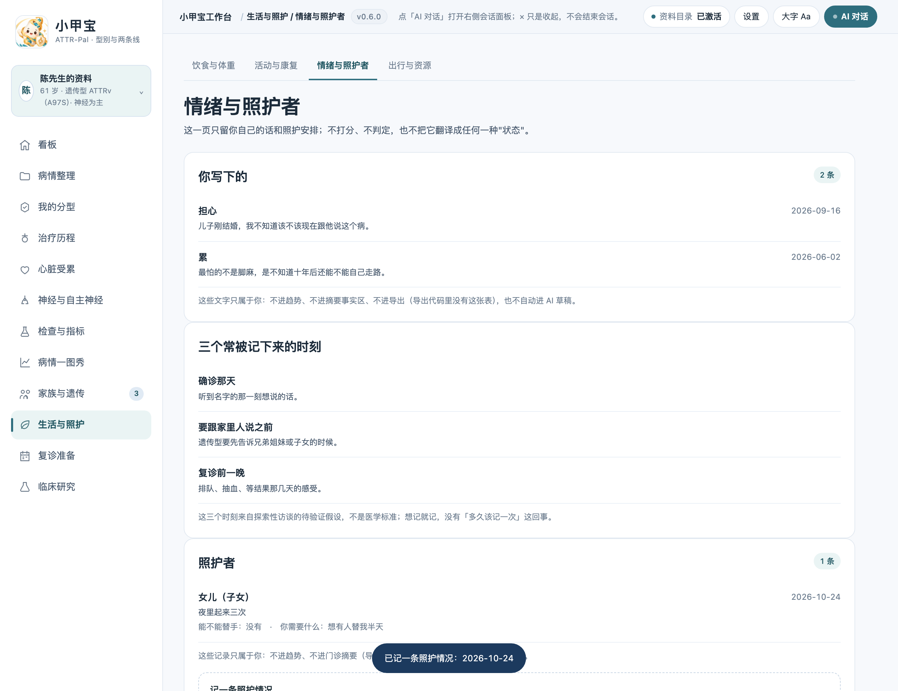
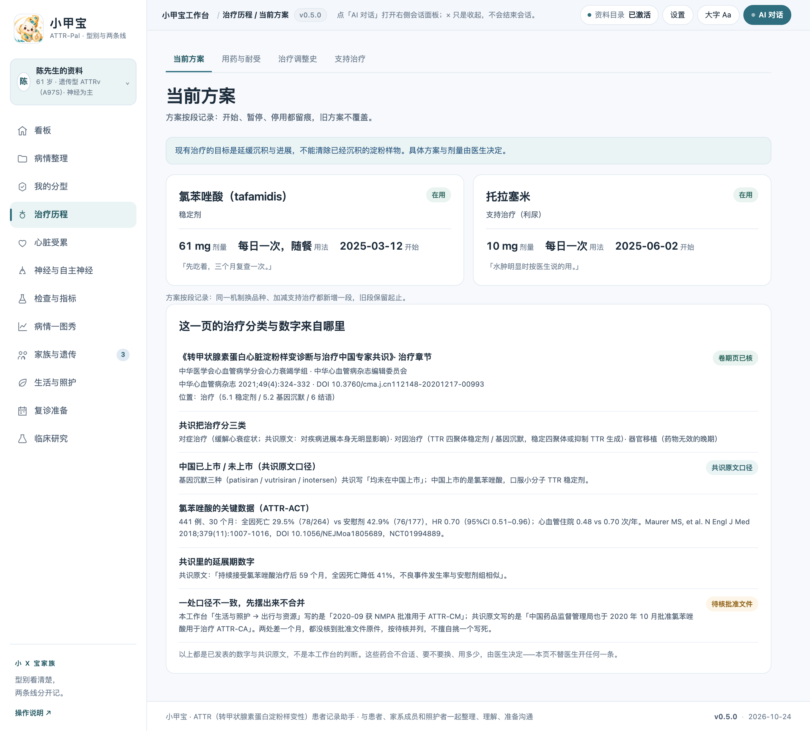
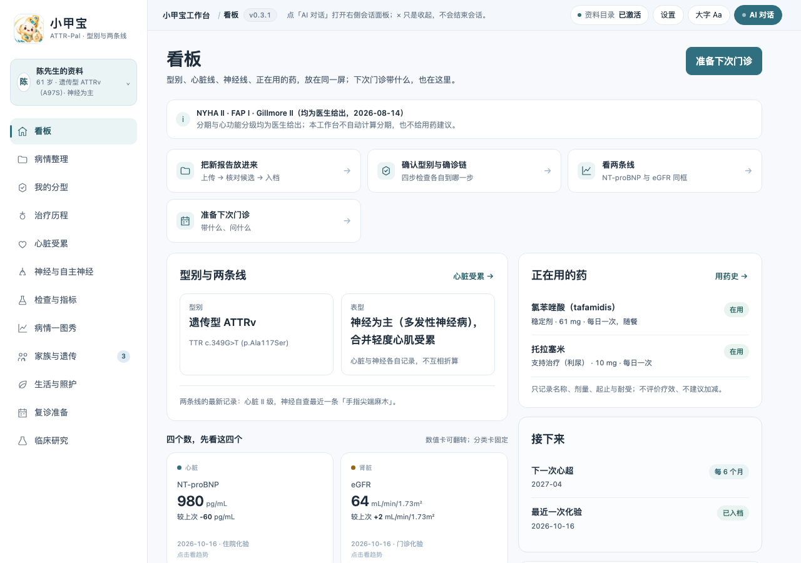

# 小甲宝 ATTR-Pal · 转甲状腺素蛋白淀粉样变性（ATTR）工作台

本机优先的 ATTR 型别确认、心脏与神经受累记录、治疗耐受与家族筛查准备工作台。
12 个一级页 / 41 个二级页签 / 30 张表；给患者、家系成员与照护者用，不给医生做诊断。

**当前状态：装机版可跑（v0.6.0）**——MinerU 上传→解析→逐项核对→入档全链路已用真实报告跑通；
**G1–G3 已于 2026-10-24 签认**（见 [SIGNOFF](docs/SIGNOFF-2026-10-24.md)），本机装机与回滚记录见
[RELEASE](docs/RELEASE.md)；市场投稿未授权、未投稿。

---

## 一、这个工作台为谁、为什么做

**开发目的**：ATTR 是一种"容易被拖很久才被认出来"的病——心衰反复查不出原因、腕管综合征做了手术、
家里有人"心脏不好"却没人提过遗传。真正确诊之后，患者手上会攥着一堆**看不懂也串不起来**的东西：
PYP 分级、轻链比值、基因报告上的一行变异、心超的室壁厚度、一张写满药名的处方。

这个工作台不是把这些变成结论，而是把**它们放回该在的位置**，让人能回答五个问题：

1. 我到底是**野生型还是遗传型**？基因报告上写的是什么？
2. **心脏**受累到哪一步？**神经**受累到哪一步？（两条线，不折算）
3. 现在用的药是什么机制、什么时候开始、有没有停过、为什么停？
4. 家里谁需要去查？我该怎么跟他说？
5. 下次门诊带什么、问什么？

**它明确不做**：不做诊断、不做分期判定、不给用药建议、不判断能不能停药、不推荐医院与医生、
不预测生存期、不做病友匹配、不解读基因变异致病性（只抄报告原文与医生结论）。

## 二、适合谁

**适合**

- **刚确诊、正在消化信息的人**：想知道自己的型别、两条受累线各在哪一步，把散落的报告收进一处。
- **遗传型（ATTRv）家庭**：需要理清"谁查过、谁没查、怎么开口"——常染色体显性，一级亲属风险高，
  这是最常问、也最难开口的事。
- **长期随访的人**：药换过几轮、NT-proBNP 与 eGFR 的趋势、每次门诊前该带什么。
- **照护者**：替家人记血压体位、记用药耐受、记"这一周最累的一件事"。

**不适合**

- 想查"我这个指标是不是恶化了""该不该换药"——这些是医生的判断，工作台一律给「由医生决定」。
- 想找医院/医生排名、病友配对、生存期数字——本工作台不提供。
- 想用它替代病历——它是**你自己这一侧的记录**，不是医院正式病历，也不与院内系统对接。

## 三、独特价值

1. **型别是两条不同的病，不合并成"淀粉样变"**：野生型（ATTRwt）与遗传型（ATTRv）分开建档。
   野生型档案不显示基因位点表，遗传型必须显示变异原文、检测方法与机构。
2. **心脏与神经是两条平行线，不互相折算**，也不给"综合评分"：心脏看 NYHA / NT-proBNP / 心超，
   神经看 FAP 分期（医生给）与自查症状——"神经重"不会被换算成"心脏轻"。
3. **看法恒不为结论**：你写下的心情、"我觉得最近稳一点"，永远只是你的话；表里没有"是否恶化"
   这类字段，界面上也不会把它翻译成任何一种状态。
4. **空 ≠ 阴性**：没记就是 `NULL`（显示「没记」），与明确写「没有」是两件事；两者在库里、
   在页面上都能分开，不会被悄悄折成 0 或"正常"。
5. **引用可点回来源**：屏幕上每句引自共识/试验的话，都要带**机构 + 版本 + 卷期页（+DOI）**；
   三样缺一样，那块直接显示「未引入」，不裸着说。
6. **本机优先 + 导出白名单**：库是本地一个 SQLite 文件（在你选的资料目录里）；门诊摘要走
   **只读白名单**，家系、看法、照护三张表在导出代码里根本不出现——不是"读了再过滤"，
   是想泄漏都没有通道。

## 四、功能清单

| # | 一级页 | 二级页签 | 它解决什么 |
| --- | --- | --- | --- |
| 1 | 看板 | — | 首屏回答"我是什么型、两条线各到哪、现在在吃什么药" |
| 2 | 病情整理 | 资料库 / 草稿核对 / 病情档案 / 指标检测 / 病情汇总 | 四层事实不合并：原件 → 解析任务 → 候选字段 → 已核对记录 |
| 3 | 我的分型 | 型别与基因 / 表型与分期 / 确诊路径 / 会诊与二次意见 | 确诊是一条链（PYP + 轻链 + 基因），链上每步留原文 |
| 4 | 治疗历程 | 当前方案 / 用药与耐受 / 治疗调整史 / 支持治疗 | 稳定剂 / 基因沉默 / 支持治疗，机制不同、监测不同 |
| 5 | 心脏受累 | 心衰症状与体征 / 心超与影像 / 心律与晕厥 / 血压与用药耐受 | ATTR-CM 主战场；体位性低血压是特征性难题 |
| 6 | 神经与自主神经 | 感觉与运动 / 自主神经 / 腕管与脊柱 / 跌倒与安全 | ATTRv-PN 与 ATTRwt 都常有神经线索 |
| 7 | 检查与指标 | 心脏指标 / 肾脏与电解质 / 体重与血液 / 影像与基因报告 | 指标卡按类别分组，按 CTCAE 阈值「对照」而非诊断 |
| 8 | 病情一图秀 | 数值曲线 / 事件与节点 / 数据口径 | NT-proBNP + eGFR 双数值线 + NYHA 分类节点；单点不连线 |
| 9 | 家族与遗传 | 家系图 / 级联筛查 / 遗传咨询记录 | 显性遗传的级联筛查与"怎么开口"，默认折叠、默认不导出 |
| 10 | 生活与照护 | 饮食与体重 / 活动与康复 / 情绪与照护者 / 出行与资源 | 低盐、体位性低血压防护、跌倒、长途出行；情绪不做量表 |
| 11 | 复诊准备 | 复诊节奏 / 就诊准备 / 与医生讨论的问题 | 罕见病门诊时间短，准备材料决定沟通质量 |
| 12 | 临床研究 | 2026 线索 / 已收藏 / 入组问题 | 434 条登记摘录；登记 ≠ 可入组，只给线索与问题 |

**已经能用的链路**（v0.6.0）

- `public/` + `dsh/`：`npm run dev` 起本地服务（`/api/health`、`/api/bootstrap`、`POST /api/bp`、
  `GET/POST /api/caregiver`、`GET /api/export/summary`、`/api/import/*`），12 页读模型与原型逐字段 parity。
- **MinerU 解析链路**：上传（按文件哈希去重）→ 云端解析（失败留历史、重试不重置）→
  候选字段（只抄写不判断）→ 逐项确认才进指标层。规则与实测坑见
  [18-MINERU-PARSING](docs/18-MINERU-PARSING.md)。
- **交互原型** `prototypes/v0.2/`：12 一级页 / 41 页签，`python3 -m http.server` 即可打开，无需构建
  （快照冻结在 v0.1.0，不随开发版改动）。
- **演示档案 2 套**（遗传型 / 野生型），来源唯一：`demo/build-demo-data.mjs`，同时产出
  `demo-data.js` 与 `demo-data.sqlite`。
- **Schema 30 张**：`0001` 28 张 + `0003` 的 `parse_jobs` + `0004` 的 `caregiver_rows`；
  四条数据契约以 CHECK 落地，sha256 见 `schema/freeze-contract.md`。

## 五、界面

生活与照护 → 情绪与照护者：左边是「你写下的」原话，右边是照护记录位（v0.6.0 起可录入，
按日期倒序，右上角是「共几条」）。照护这块只记事实——谁在照顾你、这周最累的一件事、
有没有人能替手、你自己需要什么；不打分、不判定负担轻重。



治疗历程 → 当前方案：治疗三分类与 ATTR-ACT 数字的出处卡，口径冲突并列标「待核」，
不自行择一（v0.5.0）。



装机后的首页（Desktop profile，0.3.1 实机截屏）。



其余页面截图在 `docs/screenshots/`（01–16 按页序，`responsive-*` 为窄宽基线，
`install-*` 为装机副本实机截图）。

## 六、快速开始

```bash
npm install
npm run dev           # 本地开发服务器
npm run check         # 完整检查链（见第七节）
npm run pack:check    # 打包预检
npm pack              # 打包 tgz
npm run install:local # 装进本机 Desktop profile
```

需要 Node.js 22+、Git、包管理器和可用 DSH Desktop；用 `node:sqlite` 时另核该 Node 版本条件。
本地安装入口以当前 Desktop/CLI 帮助为准，安装后按
[06-VALIDATION-AND-RELEASE](docs/06-VALIDATION-AND-RELEASE.md) 完成真实 UI 验收并填写
[ACCEPTANCE](docs/ACCEPTANCE.md)。静态检查不代表已加载。

## 七、开发流程、PR 与脚手架

**脚手架来源**：本仓库由社区脚手架 `dsh-wb-cli` 1.4.3（revision `cf48a2c6`）生成，记录在
`.dsh-wb-starter.json`。脚手架是 **snapshot**：升级不覆盖本项目，正确做法是在临时目录用相同配置
重新生成、审阅差异后再合并（`updatePolicy` 就写在那份文件里）。家族另有一份从零到交付的提示词
[prompts/ZERO-TO-DEV.md](prompts/ZERO-TO-DEV.md)；新癌种按
[prompts/NEW-CANCER-WORKBENCH.md](prompts/NEW-CANCER-WORKBENCH.md) 起。

**分支与 PR**：`main` 保持可发布，改动走 `feat/…` `fix/…` `docs/…` 分支 → PR → 自查通过后合并；
提交信息写清"改了什么 / 为什么 / 验证了什么"。不做 force push 覆盖他人提交；同一目录可能被并行会话
同时修改，提交前先看 `git log --oneline -3` 与 `git status -sb`。

**检查链**（`npm run check`，缺一项都不算过）：

| 环节 | 脚本 | 盯的是什么 |
| --- | --- | --- |
| 版本同源 | `build-version.mjs --check` | `VERSION` 与页面 / `package.json` / `lib/version.js` 共 8 处一致；原型快照固定 0.1.0 |
| 客户端同步 | `build-client.mjs --check` | `lib/client.js` 与 `src/client.js` 未漂移 |
| 语法 | `check-syntax.mjs` | 全部 js/mjs 可解析 |
| 冻结合同 | `check-schema.mjs` | `schema/000*.sql` 的 sha256 与 `freeze-contract.md` 一致 |
| 文案红线 | `check-wording.mjs` | 不出现"建议治疗 / 可以停药 / 无需就医 / 治愈率"这类越界表述 |
| 列一致 | `check-demo-columns.mjs` | 生成器与 schema 的表 / 列 / 顺序 / 类型一致 |
| 单测 | `test/*.test.mjs` | 含 UI parity（开发版与原型逐字符）、写入口径、导入、导出、装机挂载 |
| 表数 | `check-attr.mjs` | 迁移可重放且建出 30 张表 |

**三道闸口**（G1 需求 / G2 原型 / G3 数据模型）：签认要留确认人、原话、日期、产物版本；
截图与脚本通过**不算**签认。已签认部分继承、不重复确认；超出 SPEC 的新增属新范围，需重新确认。

**改结构只能新增迁移**：`0001`–`0004` 已冻结，加表 / 加列走 `0005_*.sql`，并按
[SCHEMA §4 变化矩阵](docs/SCHEMA.md) 同步 `docs/SCHEMA.md`、`freeze-contract.md`、演示数据生成器与读模型。

**HTML 先行**：业务开发前先交付 HTML 交互原型、实际预览并由维护者确认版本 / hash 与范围；
数据设计先区分领域事实、流程状态与页面读模型。见
[14-HTML-AND-DATA-CONTRACT](docs/14-HTML-AND-DATA-CONTRACT.md)。

## 八、数据与隐私

- **库在本地**：`xyb-attr.sqlite` 放在你选定的资料目录里，路径由你定，不由程序猜。
- **三层信息边界**：① 事实（值 / 日期 / 谁说的）可做，须能点回来源；② 解释（指标含义、指南原文、
  分级规定）可做，须同时有机构 + 版本 + 页码；③ 判断（好坏 / 进展 / 方案优劣 / 停药）一句都不生成，
  固定出口是「这一句需要问你的医生」。
- **导出**：门诊摘要走只读白名单（`subjects / genotype_rows / phenotype_rows / stage_rows /
  metrics / metric_points / tolerance_rows`）；`family_rows`、`viewpoints`、`caregiver_rows`
  在导出代码里不出现。
- **上传解析**：原件按文件哈希去重后存在资料目录，相对路径入库、不落绝对路径（截图与导出都不泄露
  本机目录）；走 MinerU 云端解析时，被上传的是**你主动选的那份原件**。

## 九、还没有的

- **市场投稿**：未授权，未向官方目录提 PR；本机装机来源是本地 `.tgz`（见 `docs/RELEASE.md`）。
- **未做访谈**：H1–H5 五条假设全部标〔待访谈核实〕。
- **未查 ChiCTR / WHO ICTRP**：试验状态一律"未核实"。
- **指南引用只到"点回来源"**：机构 + 卷期页 + DOI 已核，共识正文的小节起始页还没核到原件，
  页内已逐处标注。

## 十、感谢

感谢**小 x 宝社区**与 **DataElement 社区**——这个"以患者自己那一侧为中心"的工作台形态、
三层信息边界、家族统一的代码骨架，都来自这两个社区的积累。

感谢 **sam / hhx / 繁华** 的贡献：脚手架、检查链、装机与 parity 这一套工程纪律，
让"看着还行"没法冒充"验过"。

也感谢每一位愿意把自己的报告摊开来、跟我们一起把字段名吵清楚的患者与家属——
这里面每一处"这里不能写结论"，几乎都是被某一句真实的问话改出来的。

---

许可证、作者与仓库 / 发布策略由维护者确认，见 `LICENSE`（专有许可 + 第三方归属 + 免责）与
`NOTICE.md`；品牌资源与使用限制见 `assets/README.md`。初始化来源记录见 `.dsh-wb-starter.json`，
CLI 用法见 [docs/CLI-GIT.md](docs/CLI-GIT.md)，里程碑见 [DEV-PLAN](docs/DEV-PLAN.md)，
需求与规格见 [BRIEF](docs/BRIEF.md) / [SPEC](docs/SPEC.md) / [TASKS](docs/TASKS.md)，接手前先读 [AGENTS](AGENTS.md)。
